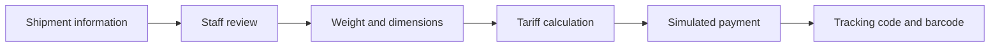
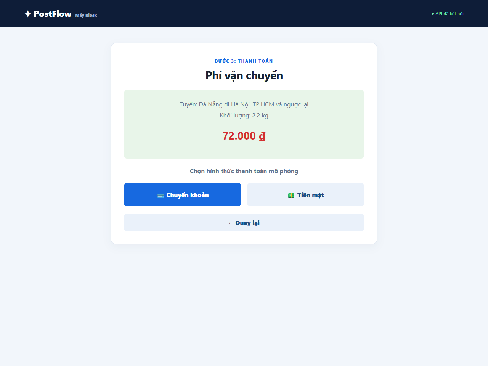
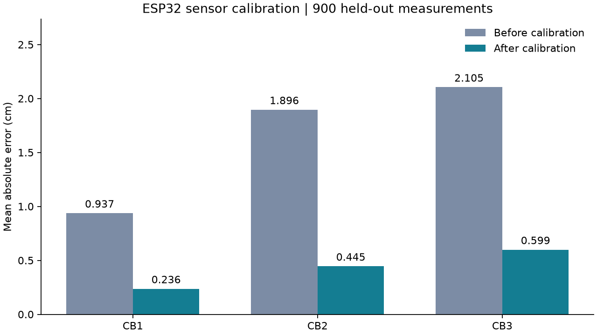

# PostFlow — AI-Assisted Postal Acceptance

**PO/PM portfolio · Business analysis · ESP32 sensor development · FPT University capstone, 2026**

PostFlow is an academic prototype that supports postal-counter staff with shipment information entry, parcel measurement, shipping-fee calculation and tracking-code generation. It combines a kiosk interface, a Python API, computer vision and an ESP32 sensor subsystem.

My contribution focuses on **business analysis and the acceptance workflow**, together with **ESP32-based parcel measurement and sensor calibration**. The AI models and application are presented as a team project. [Contribution details](docs/CONTRIBUTIONS.md).

**[Tiếng Việt](README.vi.md) · [PO/PM case study](docs/product/CASE_STUDY.md) · [CV bullets](docs/CV.md) · [Final report](docs/reports/Final_Report.pdf) · [Slides](docs/reports/Presentation_Final.pdf)**

## Explore the portfolio

| What you want to assess | Start here |
| --- | --- |
| Problem framing, users and product decisions | [Product case study](docs/product/CASE_STUDY.md) |
| MVP scope and business requirements | [PRD](docs/product/PRD.md) |
| Current and proposed acceptance workflows | [Business process](docs/product/BUSINESS_PROCESS.md) |
| Prioritization and delivery planning | [Backlog and roadmap](docs/product/BACKLOG.md) |
| Acceptance criteria and traceability to implementation | [UAT scenarios](docs/product/UAT.md) |
| Technical contribution and measurement evidence | [ESP32 subsystem](hardware/README.md) |

The product documents organize the supplied report and code into a portfolio case study. Backlog priorities and future milestones are current proposals; they are not historical sprint records.

## Product problem

Postal acceptance involves repeated entry of sender/receiver information, weighing, dimension measurement and tariff lookup. The project investigates how assisted recognition and low-cost measurement can support this workflow while keeping staff able to review and correct inputs.



The runnable demo supports manual entry, fee calculation, simulated payment and persisted completed orders. OCR, camera measurement and ESP32 measurement require their additional dependencies, models or hardware. Real bank settlement and deployment in a post office are outside this demo.

## See the prototype



[Information entry](media/kiosk-start.png) · [Simulation QR](media/kiosk-qr.png) · [Completed order](media/kiosk-complete.png)

Screenshots use fictional customer data. The QR contains a simulation payload.

## Sensor contribution

The ESP32 reads three ultrasonic sensors, adjusts the speed of sound using ambient temperature, applies linear calibration and exposes measurements over HTTP. The included calibration experiment holds out nine reference distances for testing.



| Sensor | Test MAE before | Test MAE after | Reduction in test MAE |
| --- | --- | --- | --- |
| CB1 | 0.9372 cm | 0.2363 cm | 74.79% |
| CB2 | 1.8959 cm | 0.4452 cm | 76.52% |
| CB3 | 2.1047 cm | 0.5986 cm | 71.56% |

These are controlled calibration results on **900 held-out measurements**, with 8,800 training measurements. They measure distance error, not real-world transaction-time improvement. [Data and reproduction](hardware/calibration/README.md).

## Team results reported in the thesis

| Component | Reported result | Scope |
| --- | --- | --- |
| Parcel/envelope detection | mAP@50: 99.50% | Thesis evaluation data |
| Information-region detection | mAP@50: 97.90% | Final-epoch result; small validation set |
| Vietnamese handwriting recognition | CER: 5.39%; WER: 14.99% | 1,000 test samples |
| Uncalibrated ultrasonic measurement | MAE: 0.9016–1.7445 cm | 9,700 measurements per sensor |

Source: [Final report, Chapter 5](docs/reports/Final_Report.pdf). Model results are reported team results and were not retrained during repository preparation. The raw-sensor evaluation and held-out calibration experiment use different evaluation scopes.

## Run the lightweight demo

Use Python 3.11. From the repository root, run in PowerShell:

```powershell
python -m venv .venv
.\.venv\Scripts\python.exe -m pip install -r requirements.txt
.\.venv\Scripts\python.exe -m uvicorn backend.app:app --reload
```

Open `http://127.0.0.1:8000`. Enter fictional sender/receiver details, select a service, enter weight and dimensions, then complete the simulated payment. SQLite is selected by default; no ML model or cloud key is needed for this path.

For Linux/macOS, use `.venv/bin/python` in place of `.\.venv\Scripts\python.exe`.

[Full setup, PostgreSQL and optional AI modules](docs/SETUP.md) · [Validation results](docs/VERIFICATION.md).

## Repository structure

```text
backend/              Python API, tariff rules and database adapters
index.html            Kiosk interface served by the API
app.js, styles.css    Kiosk behavior and styling
docs/product/         Case study, PRD, process, backlog and UAT
docs/reports/         Final report, slides and LaTeX sources
hardware/             ESP32 firmware, sensor client and calibration
experiments/          Original training and measurement scripts
legacy-ui/            Earlier UI variants retained for reference
model/                Model placement instructions
media/                Demo screenshots, workflow and sensor evidence
scripts/              Artifact restoration and repository checks
tests/                Tariff and demo API checks
```

The original archives, model weights, videos, raw customer images, runtime databases and private configuration are kept outside Git. [Restore local model/video artifacts](model/README.md).

## Publish your copy

Push the contents of this repository folder to a GitHub repository. [Exact PowerShell steps and suggested repository description](docs/PUBLISH.md).

Project title in the thesis: *Designing an AI-Integrated Automation System for Post Offices*. Team and supervisor credits remain in the original report. [Source provenance and packaging changes](docs/SOURCE_MAP.md).
