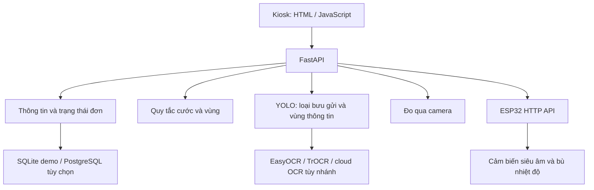

# Kiến trúc và ranh giới module

| Module | Tệp | Ghi chú |
| --- | --- | --- |
| Giao diện hiện tại | `index.html`, `app.js`, `styles.css` | Giữ tại root vì API phục vụ trực tiếp các đường dẫn này |
| API | `backend/app.py` | Endpoint nhập thông tin, đo, tính cước, đơn và barcode |
| Tính cước | `backend/pricing.py`, `backend/data/` | Quy tắc theo JSON đi kèm; chạy độc lập với model |
| Storage | `backend/database.py`, `backend/storage/` | Chọn SQLite mặc định hoặc PostgreSQL qua biến môi trường |
| Nhận dạng loại/vùng thông tin | `backend/document_processor.py` | YOLO, load model khi dùng |
| OCR và layout | `backend/hybrid_ocr.py`, `backend/ocr_processor.py`, `backend/text_layout_analyzer.py` | Nhánh xử lý khác nhau theo endpoint; cần môi trường bổ sung |
| Đo camera | `backend/dimension_detector.py`, `backend/multi_camera_detector.py` | OpenCV và weights tùy phương án |
| Firmware | `hardware/esp32/SETUP_WIFI_ESP32/` | Đọc ba sensor, hiệu chuẩn, cấu hình mạng và `/distance` |

## Ranh giới của bản demo

Luồng đã kiểm tra sử dụng nhập tay, pricing, storage SQLite, QR mô phỏng và barcode. Model không được nạp trong luồng này. Các endpoint AI/phần cứng được giữ làm mã nguồn và phải chạy trong môi trường đúng dependency/model/thiết bị.

Trạng thái draft hiện nằm trong `_orders_in_progress`; chỉ đơn hoàn tất mới được ghi DB. Đây là lý do [backlog](product/BACKLOG.md) có yêu cầu khôi phục draft trước pilot.

QR công khai được sinh từ chuỗi `POSTFLOW-DEMO|amount_vnd=...|NO_REAL_PAYMENT`, thay cho ảnh tài khoản riêng trong archive. Cơ chế thanh toán chưa xác minh giao dịch ngân hàng.
