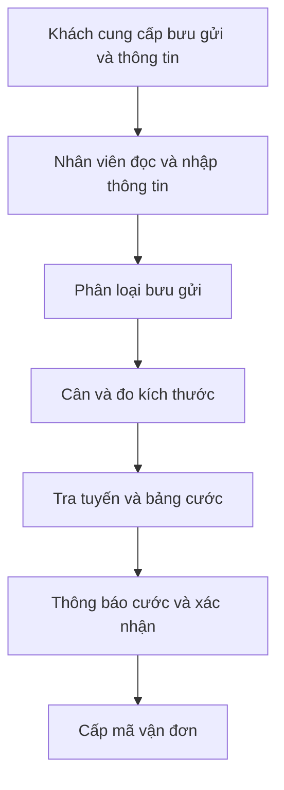
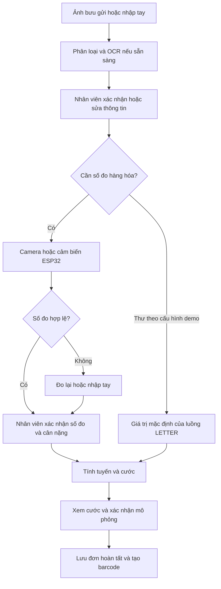
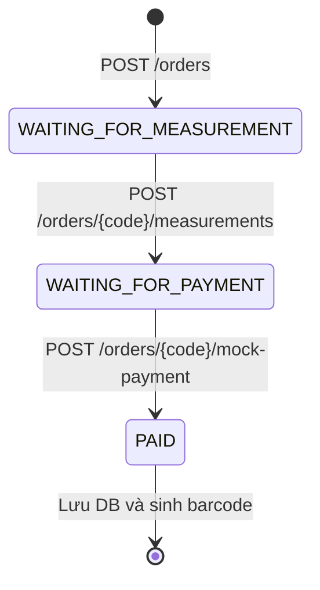

# Quy trình nghiệp vụ

Sơ đồ được hệ thống hóa từ chương 4 của báo cáo và luồng đang có trong ứng dụng.

## As-is: tiếp nhận thủ công

Các điểm cần hỗ trợ là nhập lại thông tin, đo lặp và tra cước. Sai số đầu vào có thể truyền sang khối lượng quy đổi hoặc mức giá.

## To-be: tiếp nhận có hỗ trợ

Nhánh kiểm tra độ hợp lệ của phép đo là tiêu chí nghiệp vụ cho pilot. Demo nhập tay đã có kiểm tra số dương; khả năng chặn đầy đủ mọi số đo tự động cần UAT với phần cứng.

## Trạng thái đơn trong API

Giao diện thu thập thông tin và báo cước trước, rồi gọi ba API trên khi người dùng hoàn tất bước xác nhận. Đơn chưa thanh toán chỉ nằm trong bộ nhớ của tiến trình; đơn PAID được lưu trong DB. Khôi phục đơn dang dở là hạng mục backlog.

## Điểm xử lý ngoại lệ

| Sự kiện | Hành vi cần thiết | Tình trạng |
| --- | --- | --- |
| OCR sai hoặc không khả dụng | Nhân viên sửa/nhập tay | Form hỗ trợ; OCR cần môi trường đầy đủ |
| Cảm biến timeout hoặc thiếu Echo | Báo lỗi và cho đo lại/nhập tay | Có xử lý trong mã cảm biến; cần kiểm tra thiết bị |
| Không có tỉnh/thành hoặc dịch vụ trong cấu hình | Không báo cước; trả lỗi để sửa | Có kiểm tra |
| Thiếu số đo hoặc số đo âm/0 | Không tính cước | API nhập tay có kiểm tra |
| Xác nhận thanh toán trước có số đo/cước | Không chuyển đơn sang PAID | Kiểm thử trả 409 |
| API khởi động lại lúc đang xử lý | Có thể mất đơn chưa PAID | Hạn chế hiện tại; đề xuất lưu draft |
