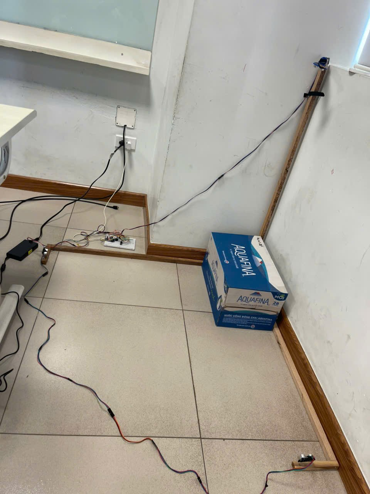
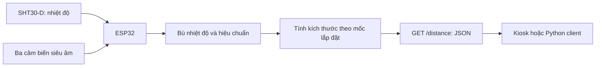

# Cảm biến ESP32 — Đóng góp cá nhân

Phần này gồm firmware, chương trình đọc dữ liệu và thí nghiệm hiệu chuẩn do chủ repository xác nhận phụ trách.



## Luồng xử lý



Firmware dùng `v(T) = 331.3 + 0.606 × T` để đổi thời gian Echo thành khoảng cách. Mỗi cảm biến được đọc lần lượt và có hệ số hồi quy riêng. Mốc lắp đặt trong bản nguồn là **105 cm**; kích thước được tính bằng `105 - khoảng cách đã hiệu chuẩn`.

## Mã nguồn và cấu hình

- [Sketch Arduino](esp32/SETUP_WIFI_ESP32/SETUP_WIFI_ESP32.ino).
- [Đọc cảm biến, Wi-Fi và HTTP](esp32/SETUP_WIFI_ESP32/wifiConfig.h).
- [Client đọc dữ liệu](sensor_client.py).
- [Notebook và workbook hiệu chuẩn](calibration/README.md).
- [Sơ đồ dây trong báo cáo](../media/sensor-wiring.png).

| Tín hiệu theo firmware | GPIO |
| --- | --- |
| Sensor 1: Trig / Echo | 27 / 26 |
| Sensor 2: Trig / Echo | 25 / 34 |
| Sensor 3: Trig / Echo | 32 / 35 |
| I²C SDA / SCL theo sơ đồ báo cáo | 21 / 22 |

Báo cáo ghi US1 dùng HC-SRF05 và US2/US3 dùng HC-SR04. Cảm biến nhiệt là GY-SHT30-D; firmware sử dụng thư viện `Adafruit_SHT31`. Bảng chân và sơ đồ phản ánh bản đồ án; việc lắp lại cần đối chiếu đúng board và module đang dùng.

## Chạy với thiết bị

1. Mở sketch trong Arduino IDE; chọn board ESP32 và cổng của thiết bị.
2. Cài thư viện dùng trong source: ArduinoJson và Adafruit SHT31 cùng các dependency của chúng; WiFi, WebServer, EEPROM và ESPmDNS đi cùng ESP32 board package.
3. Kiểm tra mốc lắp đặt 105 cm và các hệ số hiệu chuẩn trong `calibrateDistance` với cụm thiết bị của bạn trước khi dùng số đo.
4. Nạp firmware. Khi chưa có Wi-Fi đã lưu, thiết bị phát AP `ESP32-...`; mở địa chỉ cấu hình được in ở Serial Monitor, tốc độ 115200.
5. Kết nối thiết bị và máy chạy client vào cùng mạng; gọi endpoint bằng hostname hoặc IP thiết bị.

```powershell
python -m pip install requests
python hardware/sensor_client.py --url http://esp32-buudien.local/distance
```

## Cấu trúc API

Ví dụ minh họa bằng số giả lập:

```json
{
  "sensor1": {"success": true, "distance": 30.0},
  "sensor2": {"success": true, "distance": 20.0},
  "sensor3": {"success": true, "distance": 15.0},
  "temperature": 27.0,
  "volume": 9000.0
}
```

Trong **firmware này**, trường `distance` đã là kích thước bưu kiện sau phép trừ mốc 105 cm, không phải khoảng cách thô từ đầu cảm biến. Client/backend không được trừ mốc này thêm lần nữa. Đơn vị là cm và cm³. Khi thiếu Echo, sensor trả `success: false`; client hiện trạng thái không có Echo.

Phần cứng và Arduino chưa được nạp/chạy lại trong lần chuẩn bị repository. Thí nghiệm hiệu chuẩn bằng Python đã được tái chạy trên workbook kèm theo; xem [kết quả](calibration/README.md).
